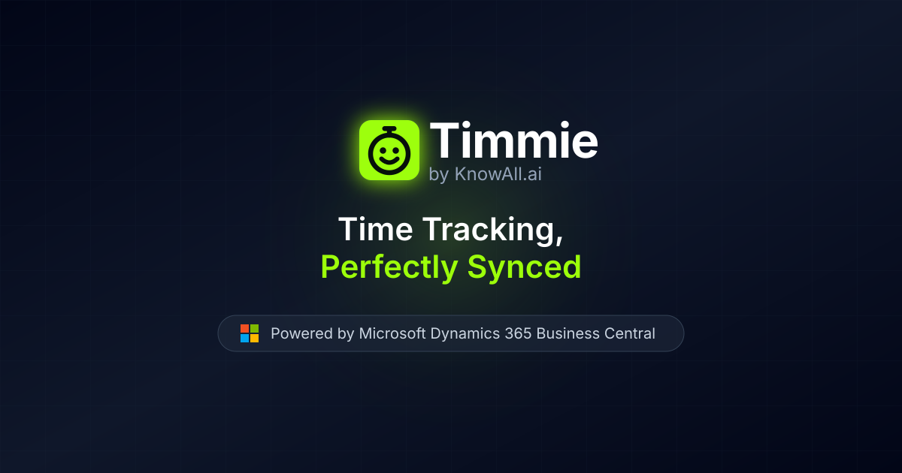
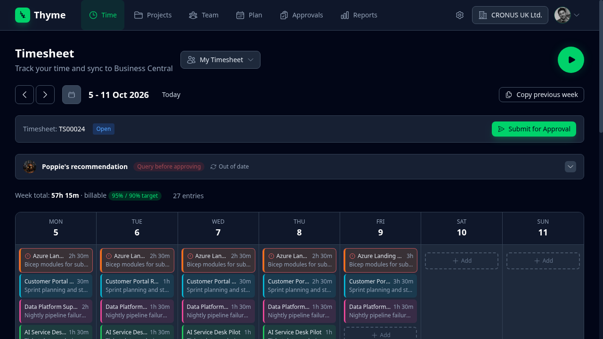
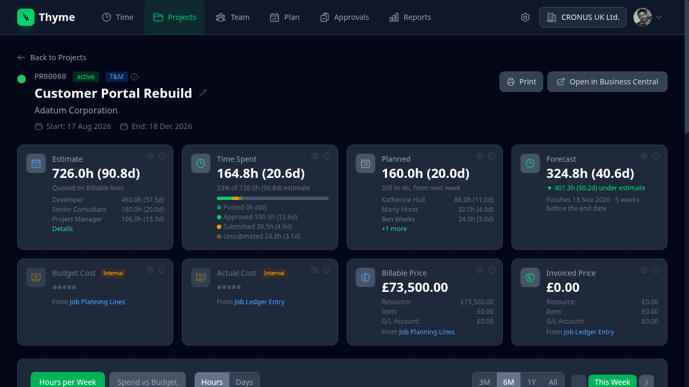
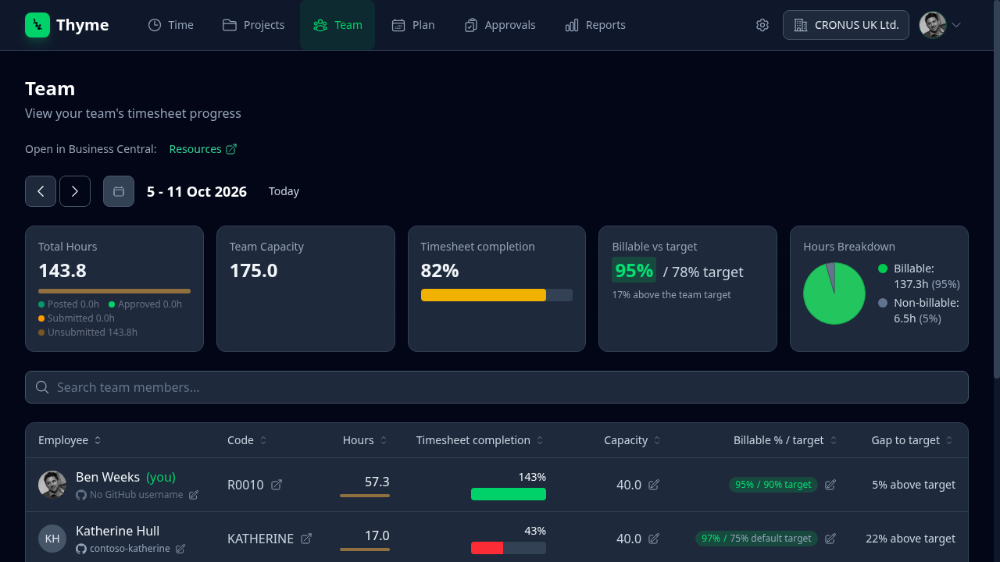
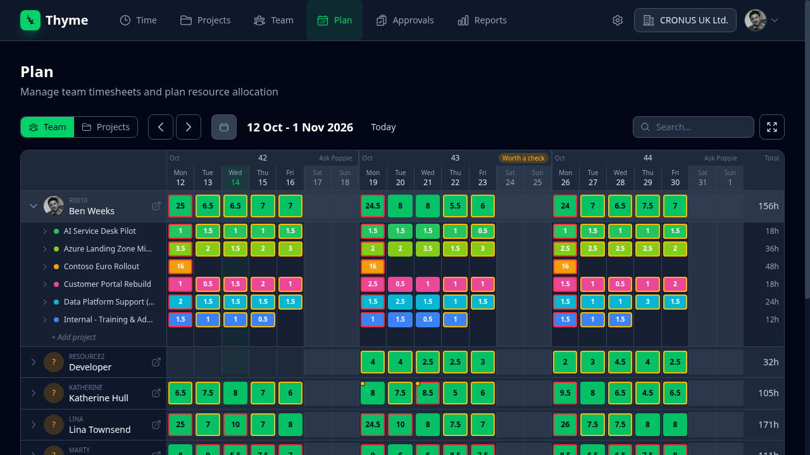
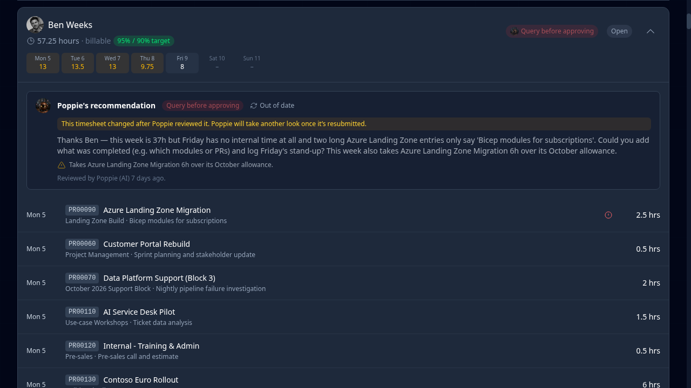
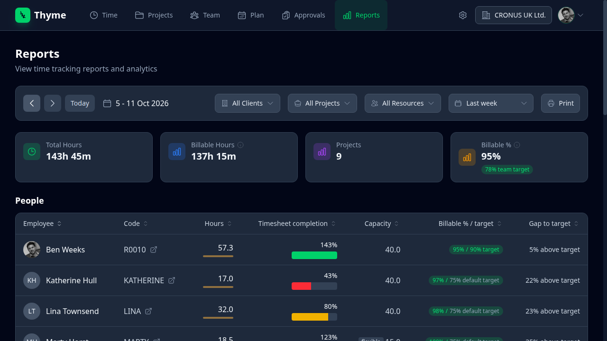
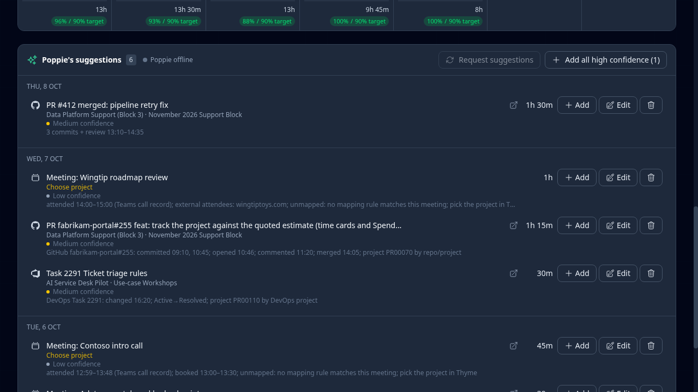
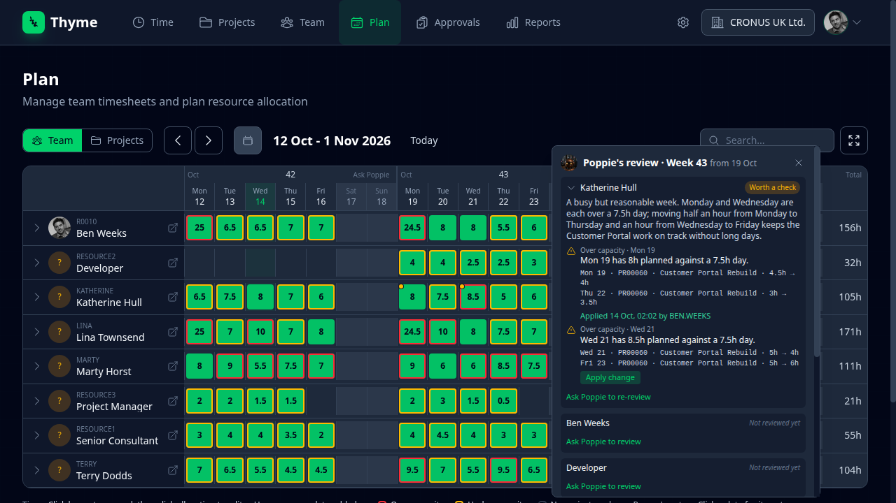

# Timmie - Time Tracking for Business Central

[](https://coderabbit.ai)



A modern time tracking web application that integrates with Microsoft Dynamics 365 Business Central. Built by [KnowAll.ai](https://knowall.ai).

## Features

### Time

- **Weekly Timesheet** - Enter time against projects and tasks in a weekly grid, or use the start/stop timer
- **Billable % against your target** - See each day's and the week's billable percentage next to your personal target
- **Less admin** - Hover over or tap an entry to see its details, and email your manager in one click if a week has no timesheet yet

### Projects

- **Track against the quote** - Compare time spent with the quoted estimate, see estimated spend to date, and forecast the outcome and finish date from planned hours
- **Spend vs Budget** - Chart spend in hours or days against an on-track line, over 3M, 6M, 1Y or All
- **Breakdown by task** - Hours per task split into Posted, Submitted and Unsubmitted, and Print or save the page as a PDF
- **Projects list** - Start and end dates and budget used by stage, with a multi-select status filter

### Team & Plan

- **Targets and capacity** - Set each person's billable target and weekly capacity, including flexible working days
- **Timesheet completion** - See how much of each person's capacity is logged, alongside their billable % against target
- **Resource plan** - Plan quarter-hour allocations by person, project and task, with over-capacity days in red and under-capacity days in amber
- **Day notes** - Mark days such as "Company Off-Site" on the Plan, optionally as days with no project work

### Approvals & Reports

- **Approvals** - Review each submitted entry on its own row with its day, the daily hours and billable % against target, then approve or reject
- **Reports** - Year to date, last year or a custom range, filtered by client and project, with a Team table and hours by project split by stage. Print it, or export to CSV with project and task names

### Timmie, our AI agent

Timmie's AI agent works alongside you. It proposes; you decide. Already run your own agent? Set its name in Settings and Timmie works with that instead.

- **Time suggestions** - Suggested entries from your calendar, GitHub and Azure DevOps activity, matched to the right project. Review each one before it's added, or request suggestions on demand
- **Linked sources** - Link a project to its repos, DevOps projects, meeting keywords and attendee domains so the agent matches that work to it
- **Timesheet review** - For approvers, the agent flags missing comments, short days, the billable mix and budget overruns, with notes against individual entries
- **Plan review** - The agent's verdict in each week's header on the Plan, checking billable targets, holidays and calendars, capacity, budget burn and quarter-hour rounding, looking closest at this week and next. If you can edit plans, apply a proposed change with one click

### Platform

- **Business Central sync** - Time entries live in your Business Central projects and timesheets, in your own tenant
- **Shareable links** - Every URL includes the environment and company, so a link opens exactly what you were looking at
- **Multi-company** - Switch between Business Central companies and environments
- **Microsoft sign-in** - Secure SSO via Microsoft Entra ID, signing you in again automatically when your session expires
- **Works anywhere** - Dark, responsive interface for desktop, tablet and phone

## Screenshots

|                                                                                                                 |                                                                                                   |
| :-------------------------------------------------------------------------------------------------------------: | :-----------------------------------------------------------------------------------------------: |
|               [](public/screenshots/timesheet.png)                |          [](public/screenshots/projects.png)          |
|                            **Timesheet** - Weekly time entry with billable % per day                            |                  **Projects** - Estimate, spend, plan and forecast for a project                  |
|                       [](public/screenshots/team.png)                       |                [](public/screenshots/plan.png)                |
|                         **Team** - Hours by stage, timesheet completion and billable %                          |                 **Plan** - Allocations by person, project and task, with capacity                 |
|               [](public/screenshots/approvals.png)                |           [](public/screenshots/reports.png)            |
|                        **Approvals** - Each entry on its own row, with the agent's notes                        |                  **Reports** - Periods, filters, hours by project and CSV export                  |
| [](public/screenshots/poppie-suggestions.png) | [](public/screenshots/plan-review.png) |
|            **Timmie's suggestions** - Time entries suggested from calendars, GitHub and Azure DevOps            |          **Plan review** - The agent's verdict for each week, with changes you can apply          |

## Tech Stack

| Layer    | Technology                   |
| -------- | ---------------------------- |
| Frontend | React 19, Next.js 16         |
| Styling  | Tailwind CSS 4               |
| State    | Zustand                      |
| Auth     | MSAL.js (Microsoft Entra ID) |
| Data     | Business Central OData API   |
| Testing  | Playwright, Vitest           |
| Runtime  | Bun                          |
| Hosting  | Azure App Service            |

## Getting Started

### Prerequisites

- [Bun](https://bun.sh) 1.0+
- Azure subscription with Entra ID
- Business Central environment

### Installation

```bash
# Clone the repository
git clone https://github.com/knowall-ai/timmie.git
cd timmie

# Install dependencies
bun install

# Set up environment variables
cp .env.example .env.local
# Edit .env.local with your Azure/BC credentials

# Run development server
bun run dev
```

Open [http://localhost:3000](http://localhost:3000) in your browser.

### Environment Variables

```bash
NEXT_PUBLIC_AZURE_CLIENT_ID=<entra-app-client-id>
AZURE_CLIENT_SECRET=<entra-app-secret>
NEXT_PUBLIC_AZURE_TENANT_ID=<tenant-id>
BC_ENVIRONMENT=<production|sandbox>
BC_COMPANY_ID=<business-central-company-guid>
```

## Development

### Scripts

```bash
bun run dev          # Start development server
bun run build        # Build for production
bun run start        # Start production server
bun run lint         # Run ESLint
bun run lint:fix     # Run ESLint with auto-fix
bun run format       # Format code with Prettier
bun run format:check # Check formatting without changes
bun run test         # Run unit tests
bun run test:e2e     # Run E2E tests
bun run typecheck    # Run TypeScript checks
bun run check        # Run all checks (format, lint, typecheck, build)
```

### Code Quality Checks

Before submitting a PR, ensure all checks pass:

```bash
bun run check
```

This runs:

1. **Format check** - Prettier formatting validation
2. **Lint** - ESLint code quality rules
3. **Type check** - TypeScript type validation
4. **Build** - Production build verification

These checks also run automatically via GitHub Actions on every PR.

### Project Structure

```
timmie/
├── .github/
│   └── AGENTS.md              # AI assistant personas
├── docs/                      # Guides, FAQs and legal (AsciiDoc)
├── scripts/
│   └── capture-screenshots.mjs  # Landing page screenshots
├── src/
│   ├── app/
│   │   ├── [environment]/
│   │   │   └── [companyId]/   # Company pages: time, projects, team, plan, approvals, reports, settings
│   │   ├── (legacy)/          # Redirects old /time, /projects… links to the company URL
│   │   └── …                  # Landing, pricing, help and legal pages
│   ├── components/            # React components
│   ├── hooks/                 # Custom hooks & stores
│   ├── services/              # API clients
│   ├── types/                 # TypeScript types
│   └── utils/                 # Utilities
├── tests/
│   ├── e2e/                   # Playwright tests
│   └── unit/                  # Vitest tests
└── public/                    # Static assets
```

## Deployment

Deploy to Azure App Service:

```bash
bun run build
# Deploy .next/standalone to Azure
```

See [docs/DEPLOYMENT.adoc](docs/DEPLOYMENT.adoc) for detailed instructions.

## Documentation

- [Solution Design](docs/SOLUTION_DESIGN.adoc) - Architecture and design
- [Deployment Guide](docs/DEPLOYMENT.adoc) - Azure setup
- [Testing Guide](docs/TESTING.adoc) - Running tests
- [Troubleshooting](docs/TROUBLESHOOTING.adoc) - Common issues
- [FAQs](docs/FAQs.adoc) - Frequently asked questions
- [Business Central Terminology](docs/bc-terminology.adoc) - How Timmie's terms map to Business Central
- [EULA](docs/EULA.adoc), [Privacy Policy](docs/PRIVACY.adoc) and [Terms of Service](docs/TERMS.adoc)

## Contributing

This is an internal tool for KnowAll.ai. For issues or feature requests, please use GitHub Issues.

## License

MIT — see [LICENSE](LICENSE). Copyright (c) 2026 KnowAll AI Ltd.
